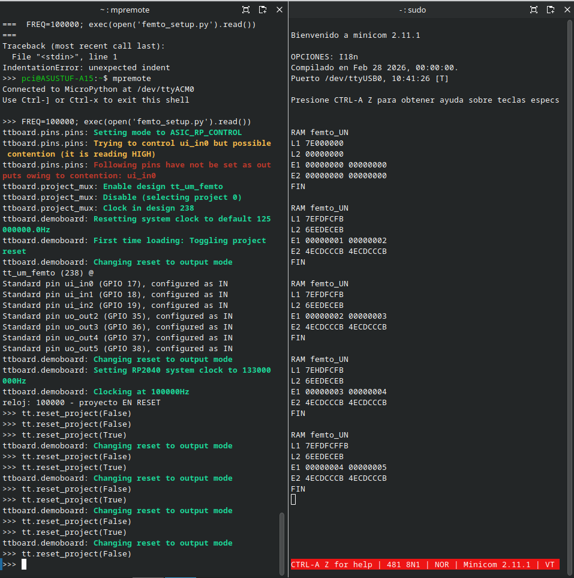
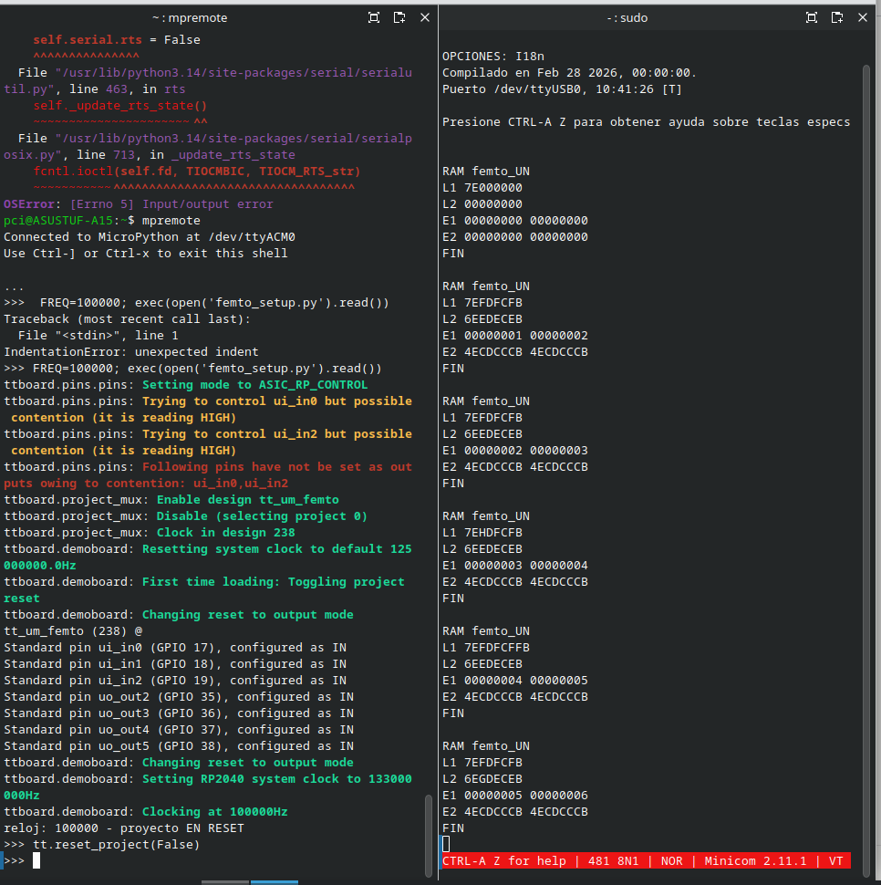
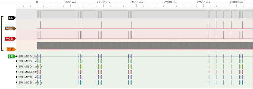

# ram_test — RAM SPI (F-RAM FM25V02) conectada al femto_UN

**Fecha:** octubre de 2026  **Estado:** Funciona en hardware (flash emulada en ESP32-C6, reloj de 100 kHz)

## Objetivo

Comprobar el segundo bus SPI del femto_UN (`tt_um_femto`), el de la memoria RAM, con dos programas:

1. **`ram_test.S`**: lee y escribe posiciones fijas de la RAM y muestra los valores por la UART.
2. **`mayus2.S`**: recibe texto por la UART, lo guarda en la RAM y lo devuelve en mayúsculas.

```
┌──────────────┐  CS, CLK, MOSI  ┌──────────────────┐  CS, CLK, MOSI  ┌────────────┐
│  ESP32-C6    │ ◄────────────── │  Demo board TT   │ ──────────────► │  FM25V02   │
│  flash SPI   │ ──────────────► │  femto_UN (ASIC) │ ◄────────────── │  F-RAM     │
│  emulada     │      MISO       │                  │      MISO       │  32 KB     │
└──────────────┘                 └──────────────────┘                 └────────────┘
                                          │ TXD/RXD
                                          ▼
                                   FTDI USB-UART ──► minicom (481 baud)
```

El problema central: **el controlador de RAM del chip nunca envía WREN (`06`)** y la FM25V02 rechaza toda escritura que no venga precedida de ese comando. Se resolvió desde el programa (ver [Cómo funciona](#cómo-funciona)).

## Hardware y herramientas

- Demo board de Tiny Tapeout con `tt_um_femto`, configurada con [`femto_setup.py`](../hello_world_uart/femto_setup.py)
- ESP32-C6 como memoria de programa, con el emulador de [`firmware/esp32_flash_emu`](../../firmware/esp32_flash_emu)
- F-RAM **FM25V02** (256 kbit = 32 KB, SPI, 3,3 V, no volátil) en una placa de pruebas aparte, solo el chip y cables
- Adaptador USB-UART FTDI, analizador lógico con PulseView
- `riscv-none-elf-gcc`, `arduino-cli`, `mpremote`, `minicom`

Antes de conectarla al femto_UN, la RAM se probó sola con el ESP32-C6: identificador `C2 22 00` y los 32 KB sin errores. Los datos que dejó esa prueba son los que leen `L1` y `L2`.

## Estructura

```
ram_test/
├── README.md
├── src/
│   ├── ram_test.S              # prueba de lectura, escritura y persistencia
│   ├── mayus.S                 # mayúsculas, primera versión (intermitente)
│   └── mayus2.S                # mayúsculas, versión que se recupera sola (la que funciona)
├── esp32/
│   ├── firmware_ram_test.h     # ram_test.S ya corrido, para el emulador (872 bytes)
│   └── firmware_mayus2.h       # mayus2.S ya corrido, para el emulador (1004 bytes)
└── img/
```

## Conexiones

Las de la flash emulada y la UART son las mismas de [`hello_world_uart`](../hello_world_uart#conexiones). La RAM va en los pines que le corresponden en la placa tester:

| Señal | Demo board | FM25V02 |
|-------|-----------|---------|
| `ram_cs_n` | `uo[3]` | CS |
| `ram_clk` | `uo[4]` | SCK |
| `ram_mosi` | `uo[1]` | SI |
| `ram_miso` | `ui[1]` | SO |
| 3V3 | 3V3 | VDD |
| GND | GND | VSS |

`femto_setup.py` ya libera `ui[1]`, `uo[3]` y `uo[4]`; no hay que cambiarlo.

## Cómo funciona

### Comandos de la FM25V02

| Código | Comando | Función |
|--------|---------|---------|
| `03` | READ | Leer |
| `02` | WRITE | Escribir |
| `06` | WREN | Habilitar escritura |
| `04` | WRDI | Deshabilitar escritura |

Cada WRITE necesita un WREN antes; al completarse, la escritura vuelve a quedar deshabilitada.

### El bus de la RAM en el chip

- El reloj SPI de la RAM vale **`clk/11`** (~9,1 kHz con `clk` = 100 kHz) y, como el de la flash, **nunca se detiene**. `CS` puede bajar en 11 posiciones (fases) distintas respecto a ese reloj.
- Si `CS` baja con el reloj en alto, se pierde el primer bit del comando: **`03` llega como `06`** (WREN) y **`02` llega como `04`** (WRDI).
- El controlador solo usa los bits 15..8 de la dirección, y el bit 31 de cada palabra leída no es válido: los programas lo descartan con una máscara `0x7FFFFFFF`.

### WREN provocado

Como el controlador nunca envía WREN, antes de cada escritura se hace **a propósito** una lectura en fase mala. La RAM la recibe como `06`, y la escritura siguiente, en fase buena, llega como un `02` válido:

```asm
    PAD  6
    lw   t0, 0(s8)     # A PROPOSITO en fase mala: la F-RAM recibe 06 = WREN
    PAD  7
    sw   s6, 0(s8)     # escritura
```

### Control de la fase: `PAD`

- Una instrucción normal dura **198 ciclos**, múltiplo de 11: no mueve la fase. La UART tampoco; solo la mueven los accesos a la RAM.
- `slli zero, zero, 2` dura **201 ciclos** y adelanta la fase 3 pasos. La macro `PAD n` inserta `n` de ellas.
- Los valores de `PAD` salieron de la simulación ciclo a ciclo del chip: los accesos normales caen en **fase 0** (`CS` baja 5 ciclos antes del flanco de subida) y la lectura que hace de WREN en **fase 8**.

> Si se agrega, quita o reordena un acceso a la RAM, **hay que recalcular todos los `PAD`**.

## Prueba 1: `ram_test.S`

Imprime por la UART:

| Línea | Posición | Qué hace |
|-------|----------|----------|
| `L1` | RAM + `0x0000` | Lee e imprime |
| `L2` | RAM + `0x1000` | Lee e imprime |
| `E1` | RAM + `0x2000` | Lee un contador, suma 1, escribe **con** WREN provocado y relee. Imprime anterior y releído |
| `E2` | RAM + `0x3000` | Igual pero **sin** WREN provocado (control) |

Termina con `FIN` y enciende el LED de `uo[6]`. `puthex` no tiene saltos que dependan del dato, para que el programa tarde siempre lo mismo y no mueva las fases.

### Resultado

Varias ejecuciones seguidas, soltando y volviendo a poner el reset desde `mpremote`:



Después de perder la conexión con la demo board (error de `mpremote` a la izquierda) y volver a arrancar, el contador sigue donde iba:



| Línea | Valor | Qué demuestra |
|-------|-------|---------------|
| `L1` | `7EFDFCFB` | Lectura: datos que dejó la prueba con el ESP32 (bit 31 descartado) |
| `L2` | `6EEDECEB` | Lectura en otra posición |
| `E1` | `00000001 00000002`, `00000002 00000003`, … | **La escritura funciona**: el releído es el anterior + 1 |
| `E2` | `4ECDCCCB 4ECDCCCB` | **Sin WREN no se escribe**: el valor no cambia |
| `E1` tras desconectar | `00000005 00000006` | **Persistencia**: la F-RAM conservó el contador |

La primera ejecución de la sesión sale toda en ceros: el cable de 3V3 de la RAM no hacía buen contacto.

## Prueba 2: mayúsculas

El programa muestra `> `, recibe caracteres por la UART (con eco), los guarda en la RAM y al recibir Enter los lee de la RAM y los devuelve con `a..z` convertidas a `A..Z`; lo demás queda igual.

### `mayus.S`: primera versión, intermitente

Funcionó con `hola` → `HOLA`, pero en otras ejecuciones fallaba sin tocar el montaje.

**Causa:** a veces el ESP32 no atiende un fetch y el femto lee `FFFFFFFF`, que ejecuta como `jal x31,-2`. El efecto alterna: una vez solo reintenta y la siguiente ejecuta además la instrucción anterior. Una instrucción repetida dura 198 (o 201) ciclos más, **mueve la fase de la RAM** y todos los `PAD` quedan desalineados: el WREN deja de llegar y las lecturas salen corridas.

### `mayus2.S`: versión que se recupera sola

Para que repetir una instrucción no haga daño:

- ninguna instrucción escribe un registro que también lee;
- antes de cada etiqueta hay un `nop`;
- no hay subrutinas (repetir un `jal` repetiría la llamada);
- no se usa `x31`/`t6`.

Para que una fase desalineada se corrija sola:

- **Escritura comprobada:** después de cada `sb` se relee; si no coincide, `PAD 1` y se repite (hasta 24 intentos).
- **Dato redundante:** cada carácter se guarda en 4 bytes (`sb` con desplazamiento 3, separación `0x500`); al leer se exige que dos bytes coincidan y que no sean `00` ni `FF`. Si no, `PAD 1` y se repite.
- **Calibración:** antes de cada `> ` escribe y comprueba una `Z` en la posición 50.
- Si tras 24 intentos no logra leer un carácter, envía `?`.
- Máximo 50 caracteres por línea; al llegar a 50 responde solo.

### Resultado

Con `mayus2.S` la conversión funciona correctamente. Bus de la RAM en el analizador durante la prueba; cada grupo de actividad son los accesos (con reintentos) de un carácter:



## Procedimiento

### 1. Compilar el programa

```bash
export PATH=~/riscv-toolchain/bin:$PATH
cd femtoRV/firmware/asm        # OBJECTS = ram_test.o  (o mayus2.o) en el Makefile
make -B CROSS=riscv-none-elf
```

Genera `firmware_shifted.bin`: 872 bytes con `ram_test.S`, 1004 con `mayus2.S`.

Para no compilar, los `.h` ya generados están en [`esp32/`](esp32).

### 2. Cargar el programa en el ESP32-C6

```bash
cd firmware/esp32_flash_emu
xxd -i <ruta>/firmware_shifted.bin > firmware.h
# o bien: cp ../../asic/ram_test/esp32/firmware_mayus2.h firmware.h
arduino-cli compile --fqbn esp32:esp32:esp32c6 .
arduino-cli upload -p /dev/ttyACM1 --fqbn esp32:esp32:esp32c6 .
```

### 3. Correr

Igual que en [`hello_world_uart`](../hello_world_uart#4-correr-la-prueba):

```bash
sudo minicom -b 481 -D /dev/ttyUSB0
```

```bash
mpremote connect /dev/ttyACM0
```
```python
FREQ=100000; exec(open('femto_setup.py').read())
tt.reset_project(False)
```

Con `mayus2`, escribir una palabra en minicom y pulsar Enter.

## Problemas encontrados

| Síntoma | Causa | Solución |
|---------|-------|----------|
| Todo se lee en `00` | Cable de 3V3 de la RAM con mal contacto | Corregir la alimentación |
| Las escrituras no cambian la memoria (`E2`) | El controlador del chip no envía WREN | Lectura en fase mala antes de cada escritura |
| El WREN provocado no cae en fase mala | La fase depende de la secuencia exacta de instrucciones | `PAD` calculados con el modelo ciclo a ciclo |
| `mayus.S` funciona a veces | Fetches fallidos repiten instrucciones y desalinean la fase | `mayus2.S`: código tolerante a repeticiones, escritura comprobada y reintentos |
| Avisos de *contention* en `ui_in0..2` al configurar | Cables del ESP32/FTDI puestos al arrancar | No impidieron la prueba |

## Limitaciones y pendientes

- Escribir depende de un efecto no previsto en el diseño (el bit perdido). Funciona, pero obliga a recalcular los `PAD` con cualquier cambio en los accesos a la RAM.
- `mayus2.S` paga la robustez en velocidad: un carácter puede requerir varias escrituras y lecturas.
- Todo a **100 kHz**, limitado por la flash emulada. A la frecuencia de diseño no se ha probado.
- Para una segunda versión del chip: que el controlador de RAM **envíe WREN** antes de cada escritura y que los relojes SPI **se detengan entre accesos** (esto último también corrige la fase 2 de la flash).

## Referencias

- RTL: [`cicamargoba/femto_UN`](https://github.com/cicamargoba/femto_UN)
- Prueba anterior: [`asic/hello_world_uart`](../hello_world_uart)
- Hoja de datos FM25V02: https://www.infineon.com/cms/en/product/memories/f-ram-ferroelectric-ram/
